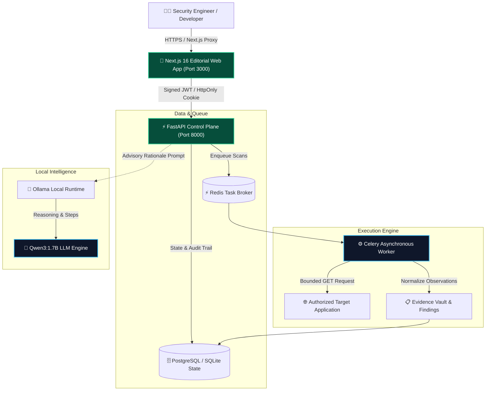

<div align="center">



<br/>

[](https://python.org)
[](https://fastapi.tiangolo.com)
[](https://nextjs.org)
[](https://docs.celeryq.dev)
[](https://redis.io)
[](https://ollama.com)
[](https://pytest.org)
[](LICENSE)

<p align="center">
  <b>Evidence-first security assessment and automated remediation platform for authorized applications and APIs.</b>
</p>

[Quick Start](#-quick-start) •
[Architecture](#-system-architecture) •
[AI Integration](#-local-ai-integration-qwen317b) •
[Workflow](#-end-to-end-workflow) •
[Security Model](#-security--threat-model)

---

</div>

## 🌟 Overview

**SentinelAI** is a modern, self-hosted web and API security evaluation workflow. Designed with an editorial ivory/cream UI and backed by a robust asynchronous worker architecture, SentinelAI eliminates the noise of unverified vulnerability reports by enforcing an **evidence-first, audit-logged assessment pipeline**.

### Why SentinelAI?

* 🛡️ **Bounded & Deterministic:** GET-only baseline checks that never follow untrusted redirects, store cookie values, or flood target endpoints.
* 🧠 **Local Advisory AI:** Embedded with **Qwen3:1.7B** running locally via Ollama to generate defensive remediation rationales without leaking target telemetry to third-party APIs.
* 📦 **Evidence Vault:** Every finding contains normalized observation records, cryptographic hashes, and verification statuses.
* 🔄 **Proof of Fix (Retests):** A vulnerability is never marked closed because it dropped off a scan; retests explicitly re-evaluate deterministic checks against original evidence.

---

## 🏛️ System Architecture



---

## 🚀 Quick Start

### Prerequisites

* **Node.js** 22+ & **Python** 3.12+ (or **Docker Desktop**)
* **Redis** (running locally or in Docker)
* **Ollama** with `Qwen3:1.7B` model (optional, for AI remediation guidance)

---

### Method A: One-Click Local Runner (Windows)

We provide a built-in startup script that automatically spins up the backend API, Celery worker, and Next.js frontend in parallel:

```powershell
# Clone the repository
git clone https://github.com/raitulh/Sentinel-AI.git
cd Sentinel-AI

# Execute the local orchestrator
.\run-local.ps1
```

Once launched:
* 🌐 **Web Interface:** [http://localhost:3000](http://localhost:3000)
* 📡 **FastAPI Docs:** [http://127.0.0.1:8000/api/docs](http://127.0.0.1:8000/api/docs)
* ⚡ **Worker Queue:** Listening on `scans` via Redis

---

### Method B: Docker Compose

For containerized deployment:

```bash
# 1. Prepare environment secrets
cp .env.example .env

# 2. Build and launch services
docker compose up --build -d

# 3. Check container health
docker compose ps
docker compose logs -f api worker web
```

---

## 🤖 Local AI Integration (`Qwen3:1.7B`)

SentinelAI includes native support for OpenAI-compatible local endpoints powered by Ollama. When a vulnerability finding is identified, SentinelAI queries **Qwen3:1.7B** for defensive, advisory remediation guidance:

```json
{
  "finding": {
    "rule_id": "header.content_security_policy",
    "title": "Content-Security-Policy missing",
    "severity": "medium",
    "priority_score": 64
  },
  "ai_rationale": "Root Cause: Missing CSP allows unauthorized content injection, risking XSS.\nSafe Steps: 1. Set Content-Security-Policy with default-src 'self'. 2. Validate implementation via browser devtools.",
  "advisory_only": true
}
```

### Enabling Local AI:

1. Install and start [Ollama](https://ollama.com).
2. Pull the model:
   ```bash
   ollama pull Qwen3:1.7B
   ```
3. Set in your `.env`:
   ```env
   AI_BASE_URL=http://localhost:11434/v1
   AI_MODEL=Qwen3:1.7B
   ```

---

## 🔬 End-to-End Workflow

```
┌─────────────────┐       ┌─────────────────┐       ┌─────────────────┐
│ 1. Workspace    │  ───► │ 2. Target Scope │  ───► │ 3. Safe Scan    │
│    Bootstrap    │       │    Attestation  │       │    Execution    │
└─────────────────┘       └─────────────────┘       └─────────────────┘
                                                             │
                                                             ▼
┌─────────────────┐       ┌─────────────────┐       ┌─────────────────┐
│ 6. Verified Fix │  ◄─── │ 5. Remediation  │  ◄─── │ 4. Normalized   │
│    Retest Job   │       │    Proposal (AI)│       │    Findings     │
└─────────────────┘       └─────────────────┘       └─────────────────┘
```

1. **Workspace Provisioning:** Seamless login/registration with auto-tenant isolation.
2. **Authorized Targets:** Register specific hosts (e.g., `https://example.com`) with operator verification acknowledgement.
3. **Safe Baseline Execution:** GET-only non-intrusive evaluation of response headers, cookies, and fingerprint disclosures.
4. **Normalized Findings:** Calculated 0–100 internal priority heuristic with explicit confidence levels.
5. **Remediation Review:** Advisory patch diffs, test plans, and local LLM explanation.
6. **Retest Lifecycle:** Single-finding verification runs that validate whether the target environment resolved the condition.

---

## 🧪 Test Suite & Quality Assurance

SentinelAI is thoroughly tested with comprehensive automated suites across backend and frontend:

```bash
# Backend unit & integration tests
cd backend
python -m pytest -v

# Frontend TypeScript validation & linter
cd frontend
npm run typecheck
npm run lint
npm run build
```

```
============================= test session starts =============================
platform win32 -- Python 3.12.10, pytest-8.4.2
backend/tests/test_api_smoke.py::test_auth_project_lifecycle_and_tenant_isolation      PASSED
backend/tests/test_api_smoke.py::test_registration_allows_only_initial_owner          PASSED
backend/tests/test_models.py::test_full_schema_creates_in_memory                       PASSED
backend/tests/test_risk.py::test_priority_score_is_bounded                             PASSED
backend/tests/test_risk.py::test_higher_severity_has_higher_priority                   PASSED
backend/tests/test_risk.py::test_confidence_and_bounds_are_applied                     PASSED
backend/tests/test_scanner.py::test_safe_baseline_reports_missing_headers             PASSED
backend/tests/test_scanner.py::test_cookie_values_are_not_stored                       PASSED
backend/tests/test_settings.py::test_production_rejects_placeholder_secrets            PASSED
backend/tests/test_settings.py::test_production_accepts_distinct_long_secrets          PASSED
backend/tests/test_settings.py::test_production_rejects_placeholder_db_password       PASSED
backend/tests/test_target_policy.py::test_target_requires_http_or_https                PASSED
backend/tests/test_target_policy.py::test_target_rejects_embedded_credentials         PASSED
backend/tests/test_target_policy.py::test_normalizes_host_and_trailing_slash          PASSED

============================= 14 passed in 3.02s ==============================
```

---

## 🔒 Security & Threat Model

* **SSRF Mitigation:** Target URL normalization rejects loopback, private ranges, metadata IPs, and embedded credentials by default.
* **Credential Hygiene:** Passwords hashed with Argon2id; JWT tokens signed and expiring; HttpOnly session cookies.
* **Deterministic Scanner:** Scanner avoids redirect chasing, nunca stores cookies or credentials, and truncates large payloads.
* **Safe AI Principles:** LLM output is strictly advisory: no shell tools, no auto-patch application, and no autonomous deployment into production.

---

## 📄 License

Distributed under the **MIT License**. See [LICENSE](LICENSE) for more information.

---

<div align="center">
  <sub>Built with care for security teams and developers. Authorized testing only.</sub>
</div>
